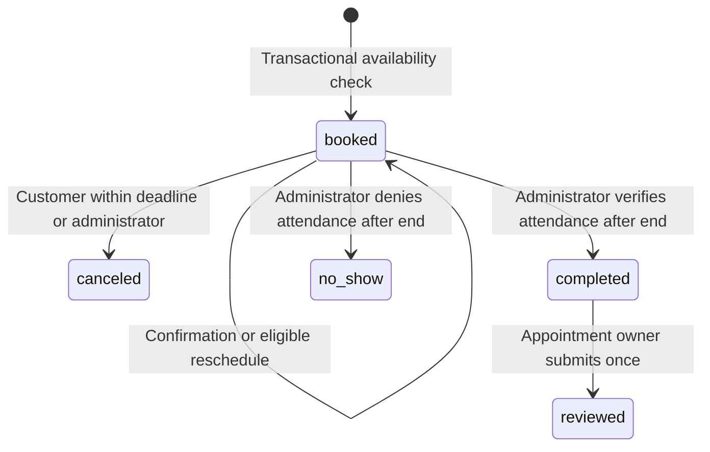
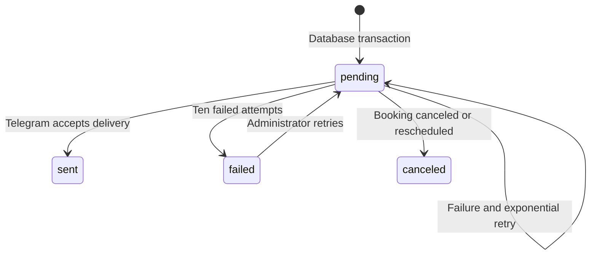

# Architecture and lifecycle

The deployment consists of a single logical application with three Python processes: HTTP API, aiogram long-polling bot, and persistent notification worker. They share SQLAlchemy models, domain services, repository lookups, configuration, and localization. The React Mini App uses one authenticated API for both customer and administrator operations.

## Identity and authorization

The API validates Telegram's signed initialization fields with HMAC-SHA256, rejects duplicate query keys, checks timestamp age, and accepts only signed positive Telegram user IDs. A Redis digest makes the launch exchange single-use. A randomly generated session token references the resolved PostgreSQL user for 24 hours. Each sensitive request resolves that user again. Administrator permission comes from `ADMIN_IDS`, never from frontend flags or caller-supplied user IDs.

The bot obtains identity from aiogram's verified Telegram update sender and handles only private chats. A user record is reused across the bot and Mini App. Explicit language selections are never overwritten by later Telegram language metadata. Sessions and rate limits require Redis; writes fail closed if the rate-limit store is unavailable.

## Availability and appointment lifecycle

All appointment timestamps are timezone-aware UTC values. Local working dates and wall-clock time windows are interpreted in the configured IANA timezone. Date-specific working windows replace weekly windows; date/weekly blocked windows subtract availability. Slots account for historical duration during rescheduling, cleanup buffer, active bookings, notice period, and booking horizon. Nonexistent wall-clock times around DST transitions are excluded.

Customer and administrator confirmation flags are independent. Canceling or rescheduling invalidates pending notification jobs. Rescheduling resets confirmation flags and queues new reminders. Service name, duration, price, and currency are snapshotted; history records the acting Telegram ID and action timestamp.

An application-wide advisory transaction lock serializes booking mutations. PostgreSQL's exclusion constraint protects against overlapping `booked` intervals even when application-level locking is bypassed. Requests have a unique client-generated idempotency key. Repeating the same key by its original owner returns the same booking; another owner cannot reuse it.

Schedule replacement checks every future active appointment against the proposed windows and blocks, and rejects incompatible changes. It never cancels appointments implicitly. Vacation ranges are represented as date-specific full-day blocking intervals.

## Notification lifecycle

Booking and job creation happen in one transaction. Each customer/admin gets an immediate booking notice and a reminder; attendance requests go only to administrators after the appointment ends. The reminder is due at the configured hour offset, or immediately if that point has passed. The worker reads the recipient's current language at delivery time.

Workers select jobs with `FOR UPDATE SKIP LOCKED` and retain the lock through delivery/commit. The booking advisory lock also prevents concurrent cancel/reschedule mutations while a job is delivered. A crash rolls back the transaction and makes pending work recoverable. Telegram delivery is at-least-once because its message-send endpoint cannot participate in the database transaction. Failed jobs are persisted and exposed to administrators.

Attendance can be deferred by two hours. Verified attendance records the administrator ID and timestamp, changes status to completed, and queues a review invitation. A no-show grants no eligibility. The unique review-to-appointment constraint and transactional review check prevent duplicate reviews.

## Support and content storage

Conversations belong to one PostgreSQL user. Both API and bot send messages through the same support service. An administrator's reply uses the conversation's stored owner as its destination. Bot replies identify the support conversation from the bot-generated message being replied to. All participants' messages persist, and administrators can close or reopen the conversation.

Image uploads are decoded and re-encoded, have opaque filenames, and live in a persistent upload volume. Public media access requires the image to be referenced by business branding, a service, or portfolio content. Support image access requires authenticated ownership or administrator permission. The bot delivers support images from local files without exposing token-bearing URLs.

## API groups

| Group | Responsibilities |
| --- | --- |
| `/api/auth` | Telegram exchange, account, language, development-only login, deletion requests |
| `/api/business`, `/api/services` | Public configurable business/service content |
| `/api/availability` | Live daily/monthly availability |
| `/api/appointments` | Ownership-protected booking, confirmation, cancellation, rescheduling |
| `/api/reviews` | Public rating summary and verified submissions |
| `/api/portfolio` | Public gallery and categories |
| `/api/support` | Private conversation and message operations |
| `/api/admin` | Authorization-protected management, dashboard, scheduling, moderation, jobs |
| `/api/uploads`, `/api/media`, `/api/private-media` | Validated image storage and delivery |

Core output contracts use Pydantic schemas with ORM attribute validation. List APIs have bounded limits and offsets; support messages also support stable ID-based pagination. Errors have a stable code and localized message. Admin APIs are protected by backend dependencies and business actions independently verify ownership/roles.

## Extension boundaries

Multiple employees/resources require adding a resource foreign key to schedule and appointment tables, resource-scoped advisory locks, and a resource equality term in the exclusion constraint. Multiple businesses additionally require tenant ownership and tenant-scoped authorization for every entity. These changes must be explicit migrations; the current application does not pretend to support those modes.
